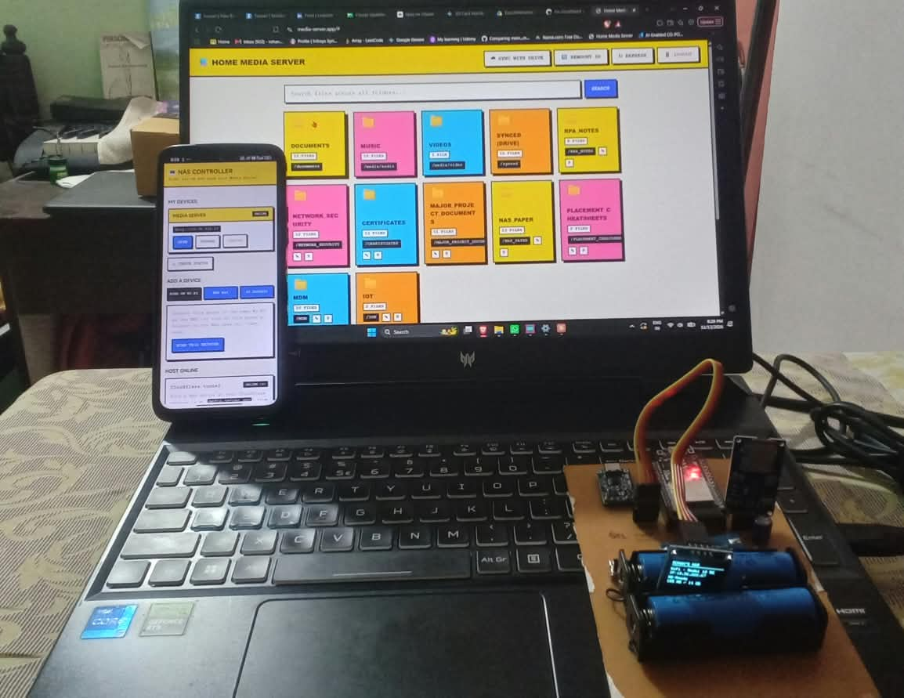
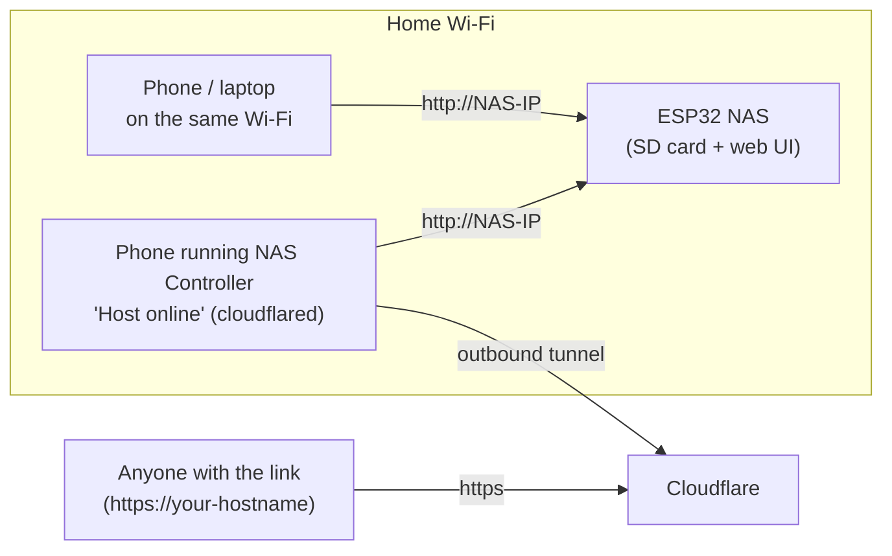

# NAS Controller

[](https://github.com/ROAHN-B/NAS-APP/actions/workflows/build.yml)

**NAS Controller** is the Android companion app for an **ESP32 Home Media Server**, a small DIY NAS built on an ESP32 and an SD card. With the app you can find your NAS on Wi-Fi, set up a new one, open it, choose its Google Drive folder, and put it online at your own web address through a Cloudflare tunnel. You don't need Termux or a computer.

The app is a [Capacitor](https://capacitorjs.com/) app: a single web page (`public/index.html`) plus a few small native Android plugins.

<p align="center">
  
</p>
<p align="center"><em>The whole setup: the ESP32 NAS (front right, with its OLED status screen), the NAS Controller app on the phone, and the NAS web interface open on the laptop through its Cloudflare address.</em></p>

---

## Contents

- [Features](#features)
- [How it fits together](#how-it-fits-together)
- [Requirements](#requirements)
- [Install the app](#install-the-app)
- [Using the app](#using-the-app)
- [One-time Cloudflare tunnel setup](#one-time-cloudflare-tunnel-setup)
- [Building from source](#building-from-source)
- [Project structure](#project-structure)
- [NAS endpoints used by the app](#nas-endpoints-used-by-the-app)
- [Security notes](#security-notes)
- [Troubleshooting](#troubleshooting)
- [Roadmap](#roadmap)

---

## Features

| Feature | What it does |
|---|---|
| **My devices** | Your saved NAS devices with a live Online / Not reachable status, and buttons to Open, Rename or Remove each one. Saved on the phone. |
| **Find on Wi-Fi** | Scans the phone's Wi-Fi network (or its hotspot) for NAS devices and lets you add them in one tap. Mobile data and VPN are skipped. Only real NAS devices are listed, so your router isn't mistaken for one. |
| **Set up a new NAS** | Step-by-step guide for joining the NAS's `ESP32-NAS-Setup` hotspot and opening its Wi-Fi setup page. |
| **Add by address** | Add a NAS by its local IP (e.g. `192.168.1.40`) or by its Cloudflare address to use it from anywhere. |
| **Open** | Opens the NAS web interface inside the app. The phone's Back button returns to your device list. |
| **Drive folder** | View and change the Google Drive folder each NAS syncs and uploads to. Paste a folder link, and the NAS checks it with Google and shows *Verified: "folder name"* or the reason it can't be used. |
| **Host online** | Runs a Cloudflare tunnel on this phone so the NAS is reachable at your own web address from anywhere. Runs in the background with a notification and a Stop button, and shows a live status and log. |
| **SD card decryptor** | Decrypts a file copied straight from the NAS's encrypted SD card (AES-128-CTR) and saves it to `Documents/NAS-decrypted/`. |

---

## How it fits together



- **On the same Wi-Fi**, the app and browsers talk to the NAS directly by its IP address.
- **From anywhere**, people open your Cloudflare address. One phone at home runs the tunnel in the app (**Host online**) and passes requests to the NAS. Only that phone needs it; everyone else just opens the address.
- The **NAS firmware** (an Arduino sketch for the ESP32) is a separate project and isn't part of this repository. The app needs its web endpoints, listed [below](#nas-endpoints-used-by-the-app).

---

## Requirements

- An Android phone. **Host online** needs a 64-bit ARM phone (almost every phone from the last several years).
- The **ESP32 Home Media Server firmware** running on your NAS. The **Drive folder** feature needs firmware that has `/api/drive-folder`.
- For **Host online**: a Cloudflare account, a domain on Cloudflare, and a named tunnel. See [One-time Cloudflare tunnel setup](#one-time-cloudflare-tunnel-setup).
- The phone that hosts the tunnel must be on the **same Wi-Fi as the NAS**.

---

## Install the app

1. Open the [Actions tab](https://github.com/ROAHN-B/NAS-APP/actions/workflows/build.yml) and select the latest successful **Build Android APK** run.
2. Under **Artifacts**, download **NAS-Controller.apk** (it comes as a `.zip`; unzip it to get `app-debug.apk`).
3. Copy it to your phone, open it, and allow **Install unknown apps** if Android asks.

> If an older build is installed and the new one says *"App not installed"*, uninstall the old one first. Builds from different machines are signed with different debug keys.

---

## Using the app

### Find and add your NAS
1. Connect the phone to the same Wi-Fi as the NAS (or turn on the phone's hotspot if the NAS uses it).
2. **Add a device → Find on Wi-Fi → Scan this network**.
3. Tap **Add** next to your NAS. It appears under **My devices** and turns **Online**.

### Set up a brand-new NAS
1. Power on the NAS. Without saved Wi-Fi, its screen shows **Configure WiFi**.
2. In the phone's Wi-Fi settings, join **`ESP32-NAS-Setup`** (password `12345678`).
3. If Android doesn't open the setup page by itself, go to **New NAS → Open setup page**.
4. Choose your home Wi-Fi and save. The NAS restarts and joins it.
5. Reconnect the phone to your home Wi-Fi and use **Find on Wi-Fi**.

### Change the Google Drive folder
1. On the NAS card, tap **Drive folder**.
2. Enter the NAS's **Drive sync password** and tap **Show current** to see the folder in use.
3. Paste a new link such as `https://drive.google.com/drive/folders/…` and tap **Save folder**.
4. Wait a few seconds for **Verified: "folder name"**. If it shows a problem, make sure the folder belongs to, or is shared as **Editor** with, the Google account the NAS is connected to.

After switching folders, the next **Sync with Drive** on the NAS uploads the files in `/synced` into the new folder. The old folder isn't changed.

### Put the NAS online (Host online)
1. Copy your tunnel key file (`<tunnel-id>.json`) to the phone (see the [setup](#one-time-cloudflare-tunnel-setup)).
2. **Host online → Import key**, and pick the file. The key stays in the app's private storage.
3. Choose the NAS to put online and tap **Start tunnel**. The badge changes to **Online (4)** when Cloudflare is connected.
4. Tap **Battery settings** and set NAS Controller to **Unrestricted** / **Don't optimise**, so Android doesn't stop the tunnel.

### Decrypt a file from the SD card
**Tools → Decrypt a file from the SD card**: pick the file, enter the NAS's 16-byte AES key (`0xA1, 0xB2, …` or 32 hex characters), and tap **Decrypt & save**.

---

## One-time Cloudflare tunnel setup

Do this once, on any computer or in Termux, with [`cloudflared`](https://developers.cloudflare.com/cloudflare-one/connections/connect-networks/downloads/) installed:

```bash
cloudflared tunnel login                          # pick your domain in the browser
cloudflared tunnel create my-nas                  # creates ~/.cloudflared/<tunnel-id>.json
cloudflared tunnel route dns my-nas nas.example.com
```

- Import `~/.cloudflared/<tunnel-id>.json` into the app (**Host online → Import key**).
- The app runs `cloudflared --no-autoupdate tunnel --grace-period 2s run --url http://<NAS-IP> --credentials-file <key> <tunnel-id>`, so no `config.yml` is needed.
- **Use your own hostname:** add it to `server.allowNavigation` in [`capacitor.config.json`](capacitor.config.json), so the app opens it inside itself rather than in the browser.

---

## Building from source

**Easiest:** push to `main`. [GitHub Actions](.github/workflows/build.yml) builds the APK, including `cloudflared`, and uploads it as an artifact. You can also start it by hand from the Actions tab (**Run workflow**).

**Locally** you need Node.js 20, JDK 17 or 21, and the Android SDK (platform 34):

```bash
npm install --legacy-peer-deps
npx cap sync android
cd android
./gradlew assembleDebug
```

The APK is written to `android/app/build/outputs/apk/debug/app-debug.apk`.

**cloudflared in local builds.** The tunnel binary isn't committed. CI builds it from the official source for Android (arm64) with the Android NDK, so it uses Android's DNS resolver, and places it at `android/app/src/main/jniLibs/arm64-v8a/libcloudflared.so`. A local build without that file works, but **Host online** reports that the phone isn't supported. To build it yourself, follow the *Build cloudflared for Android (arm64)* step in [`build.yml`](.github/workflows/build.yml). The version is set by `CLOUDFLARED_VERSION`.

---

## Project structure

| Path | What it is |
|---|---|
| [`public/index.html`](public/index.html) | The whole app interface: devices, scan, setup, Drive folder, Host online, decryptor. |
| [`public/capacitor.js`](public/capacitor.js) | Capacitor's browser runtime (copied from `@capacitor/core`), so plugins work without a bundler. |
| [`android/.../MainActivity.java`](android/app/src/main/java/com/rohan/nascontroller/MainActivity.java) | Registers the plugins; the Back button returns from a NAS page to the device list. |
| [`android/.../NetInfoPlugin.java`](android/app/src/main/java/com/rohan/nascontroller/NetInfoPlugin.java) | Lists the phone's Wi-Fi/hotspot addresses so the app knows which network to scan. |
| [`android/.../TunnelPlugin.java`](android/app/src/main/java/com/rohan/nascontroller/TunnelPlugin.java) | Imports and removes the tunnel key; starts, stops and reports on the tunnel. |
| [`android/.../TunnelService.java`](android/app/src/main/java/com/rohan/nascontroller/TunnelService.java) | Background service that runs `cloudflared`, keeps Wi-Fi awake, and shows the notification. |
| [`capacitor.config.json`](capacitor.config.json) | App ID, plain-HTTP access to the local NAS, and which addresses open inside the app. |
| [`.github/workflows/build.yml`](.github/workflows/build.yml) | CI: builds `cloudflared` for Android (cached), then the APK, and checks the binary is inside it. |
| [`server.js`](server.js), [`start_nas.js`](start_nas.js) | **Optional, legacy:** the old Termux way of running the tunnel. The app's Host online feature replaces them. |

---

## NAS endpoints used by the app

| Endpoint | Used for |
|---|---|
| `GET /login` | Detecting a NAS during scans and status checks (the page title contains "Media Server"). |
| `GET /` and the rest of the web UI | Opening the NAS inside the app. |
| `POST /api/drive-folder` | Reading, changing or re-checking the Google Drive folder. Form fields: `pwd` (Drive sync password), optional `folder` (link or ID), optional `check=1`. Returns JSON with `folderId`, `link`, `status` (`unchecked` / `checking` / `ok` / `error`), `message` and `isDefault`. |
| `http://192.168.4.1/` | The NAS's own Wi-Fi setup page, while the phone is on its setup hotspot. |

---

## Security notes

- **The tunnel key is a secret.** Anyone with your `<tunnel-id>.json` can run your tunnel. The app keeps it in private storage; it's never part of the APK or this repository. Don't commit it.
- **The Drive sync password** protects changing the Drive folder. It's sent over your local network; when using the NAS remotely, it goes through Cloudflare's HTTPS.
- **Local NAS traffic is plain HTTP** (the ESP32 can't do HTTPS quickly), so use it on networks you trust. Remote access through Cloudflare is HTTPS.
- **Firmware secrets:** keep your Google OAuth client secret, refresh token and NAS passwords out of any public repository.

---

## Troubleshooting

| Problem | What to do |
|---|---|
| **Find on Wi-Fi finds nothing** | Make sure the phone is on the same Wi-Fi as the NAS. College/office Wi-Fi often blocks devices from seeing each other ("client isolation"); use the phone's hotspot for the NAS instead. |
| **A saved NAS shows "Not reachable"** | Its IP may have changed after a router restart. Scan again, or reserve an IP for the NAS in your router. |
| **Cloudflare error 1033** | No tunnel is connected. Start **Host online** on the phone at home. |
| **Cloudflare error 502 / "Unable to reach the origin"** | The tunnel is up but can't reach the NAS. Check the hosting phone is on the NAS's Wi-Fi and the NAS's IP hasn't changed. |
| **Host online stops when the screen is off** | Set the app's battery usage to **Unrestricted** (Host online → Battery settings). |
| **Host online says the phone isn't supported** | The APK was built without `cloudflared`, or the phone isn't 64-bit ARM. Use the APK from GitHub Actions. |
| **Drive folder: "Folder not found…"** | Share the folder (as Editor) with the Google account the NAS uses. If it still fails for a folder you own, the NAS's Google token may only have the limited *drive.file* permission; create a new token with full Drive access. |
| **Drive folder: "needs the latest firmware"** | Flash the latest ESP32 NAS sketch, which includes `/api/drive-folder`. |

---

## Roadmap

Planned improvements, on both the app and the NAS:

- **Security:** POST-only actions, path checks, secrets stored on the device, hashed passwords with lockout, short-lived stream links.
- **Storage:** faster SDMMC wiring, real folders and subfolders, a recycle bin, scheduled Drive backups.
- **Sharing:** several user accounts with folder permissions, and share links with expiry.
- **Access:** WebDAV, so the NAS opens as a network drive on Windows, macOS, iOS and Android.
- **App:** automatic camera-photo backup, "Save to NAS" from the Share menu, notifications.

---

## License

No license has been chosen yet. All rights reserved by the author until one is added.
